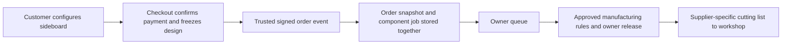

# Customer order → cutting list → workshop

This is the intended operating workflow. Manual component entry is a fallback and engineering tool; customers should not require the owner to retype their designs.



## Implemented in code

- `POST /api/orders/confirmed` is an internal signed-event intake for a future checkout adapter. It is **not a customer checkout**, a Stripe webhook or an order form. The adapter must verify the actual payment and approved quote before calling it.
- The event freezes the canonical K3 design, quantity, order/payment references, paid total in integer pence and pricing-rule version. No customer name, address, email or card data is accepted or needed by this processing queue.
- HMAC-SHA256 signs the exact timestamp and body. Missing/invalid signatures and timestamps outside five minutes are rejected. Bodies are bounded to 4 KB.
- An event creates a linked component draft automatically, using the exact configuration and quantity. There is no owner re-entry step to create that draft.
- `lib/confirmedOrderStore.ts` has a dedicated Upstash Redis adapter. Its Lua operation writes the immutable order envelope, component draft, event marker and queue index atomically. Repeated events do not create duplicate components; the same order ID with a changed snapshot returns conflict rather than overwriting the original. Storage failures return a retryable error, never a successful acknowledgement.
- The owner workspace has an incoming-order queue. In the protected preview it reads received **test** orders from `GET /api/owner/orders`. Opening a draft retains its order identity, configuration reference and paid-price rule version. An existing local working copy is not overwritten when reopened.
- Order identity and engineering hold survive local backups and appear in the draft CSV. Specification work in the component editor is still browser-local; it does **not** update the immutable received-order record in the queue.
- Automatic jobs are on **engineering hold** and supplier release is blocked. No approved production compiler exists. Checking review boxes or importing a backup cannot mark one of these generated jobs production-ready.

## Intentionally inactive / not yet implemented

- No live checkout, paid order acceptance or payment provider settings have been activated.
- No complete, approved manufacturing compiler exists. The provisional carcass preview still omits fronts, plinth/base components, drawer boxes, hardware, machining and material/edge specifications. It cannot be sent to the workshop as a complete cutting list.
- Order queue credentials and a trusted checkout sender are not configured or externally tested. The Redis Lua operation is implemented but has not been exercised against a real managed database in this task. Automated service tests use an explicit in-memory test store, never a production fallback.
- Production owner login, shared editing, immutable issued revisions, cancellations/amendments, retention/backup operations, supplier acknowledgement/reconciliation and delivery retries are still required.
- There is no Cworkshop API adapter, verified upload template or email dispatch. No supplier has received an order or message.

## Trusted event contract

```json
{
  "version": 1,
  "eventId": "payment-event-unique-id",
  "orderId": "KR8A-ORDER-REFERENCE",
  "mode": "test",
  "confirmedAt": "2026-10-29T12:00:00.000Z",
  "paymentStatus": "paid",
  "paymentReference": "verified-provider-reference",
  "designCode": "K3-2000-750-450-DDDD-SSSS-1111-0-oak-mat-plt-psh-0",
  "quantity": 1,
  "amountPence": 100000,
  "currency": "GBP",
  "pricingRulesVersion": "TEST-ONLY-NOT-AN-APPROVED-RATE-CARD"
}
```

The amount above is test data, not a KR8A price. A payload cannot supply its own manufacturing approval or release status.

Headers:

- `Content-Type: application/json`
- `X-KR8A-Timestamp`: current Unix seconds.
- `X-KR8A-Signature`: `sha256=` followed by HMAC-SHA256 hex of `timestamp + '.' + exactJSONBody`, using the server-only `ORDER_WEBHOOK_SECRET`.

After a timeout or 503, retry the same order snapshot/event with a fresh signature timestamp. A 409 requires reconciliation; do not alter the original order to make a retry succeed. This contract handles confirmations only; amendments/refunds/cancellations need their own authenticated, versioned workflow before live manufacturing.

## Activation boundaries

Everything is off by default in `.env.example`. No secrets should be placed in browser code or `NEXT_PUBLIC_*` settings.

- `ORDER_INTAKE_ENABLED=true` plus a 32+ character signing secret and dedicated `ORDER_REDIS_REST_URL` / `ORDER_REDIS_REST_TOKEN` enables **test-mode intake only in preview/local development**.
- The order store must be durable, non-evicting and backed up; do not reuse disposable rate-limit storage. The upstream commerce system remains responsible for the authoritative paid order and its frozen design/quote.
- Production additionally requires `ORDER_LAUNCH_APPROVED=true`. Do not set it until checkout, order storage, pricing, manufacturing rules, owner authentication, cancellation handling and supplier release have passed a real reference-order test and the owner authorizes launch.
- The owner queue API remains 404 in production until authenticated owner access is implemented. The current preview relies on existing Vercel deployment SSO; preserve deployment protection during tests.
- No flag in this implementation enables supplier release: that remains hard-blocked until a versioned manufacturing compiler and reviewed supplier handoff are implemented.

## Next manufacturing milestone

Approve one reference sideboard construction with the workshop: panel/front/back thicknesses, plinth construction, divider positions, reveals, drawer-box and runner rules, joinery/drilling, grain, decor and edging codes, tolerances and finished-versus-cut size conventions. Encode that approved specification as a versioned pure compiler shared by geometry validation and order generation. Compare its full BOM to a workshop-reviewed reference before enabling release.

The owner release should then freeze an issued CSV/drawing package and supplier specification version. Initial release should require owner approval; a later automatic release can follow once reference orders and exception handling are validated.

## Verification

49 automated tests pass. New coverage checks exact signed snapshots and quantities, duplicate/concurrent retries, changed-order conflicts, replay/tamper rejection, invalid/unpaid events, storage failures, engineering-hold persistence and production activation gates. Build and TypeScript checks pass. External queue/payment/supplier integration is not represented as tested.
